# OpenRath

A free, open source home screen for any Android-based aftermarket car stereo, whatever its make. It replaces the stereo's own launcher with a dashboard you can rearrange: your car with live speed, the clock, weather, a map with turn-by-turn guidance, radio and music, a trip computer and fuel log, and many driving helpers (speed limits and cameras, parking spot, service reminders, dashcam, voice commands, steering-wheel buttons). Every feature has its own switch under "Turn on or off" in its Settings section.

*Rath* (रथ) is Sanskrit for chariot.

**Goal:** one launcher for every Android aftermarket stereo. The core uses only standard Android; anything that needs a stereo maker's own services (Topway, FYT, MTCD/Joying) is an optional add-on with its own switch, so no feature depends on one maker.

## Screenshots

Taken on a 1024 x 600 screen, the usual 7 inch stereo size.

**Dashboards**

<table>
<tr>
<td align="center">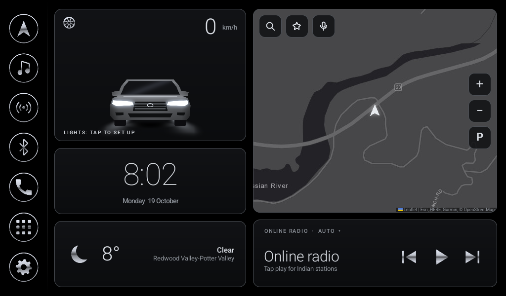 Boxes</td>
<td align="center">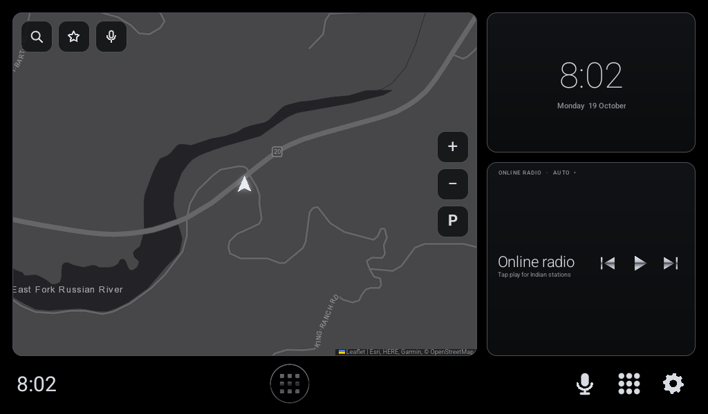 Wide map</td>
</tr>
<tr>
<td align="center">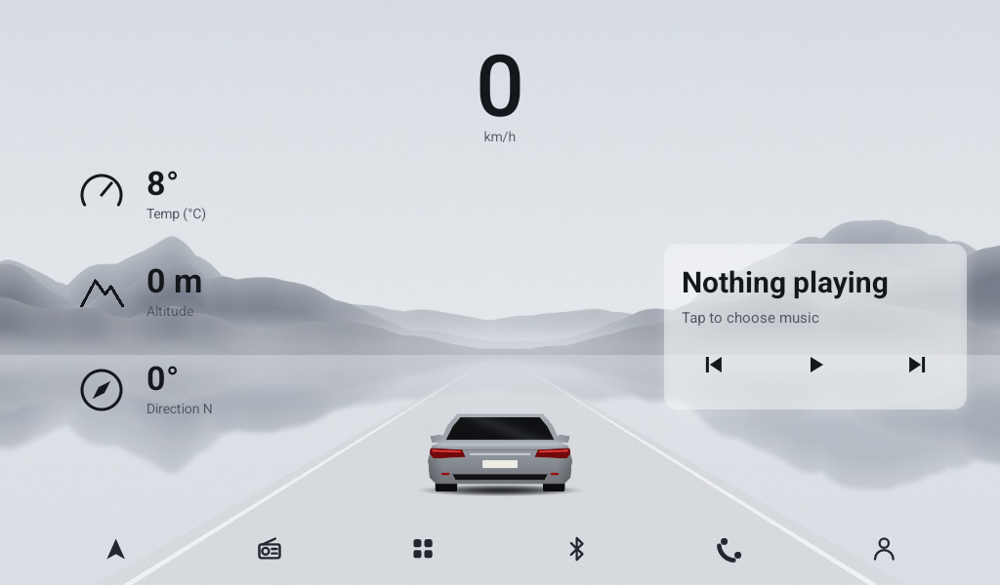 Scenery</td>
<td align="center">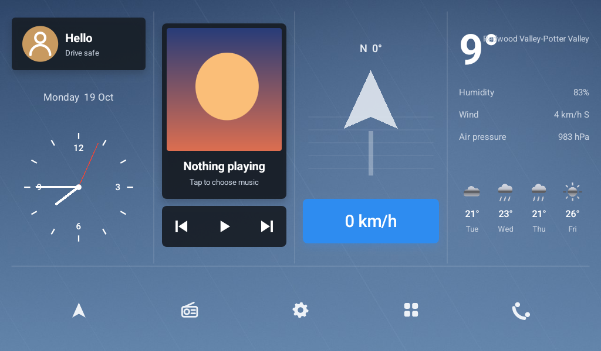 Columns</td>
</tr>
<tr>
<td align="center">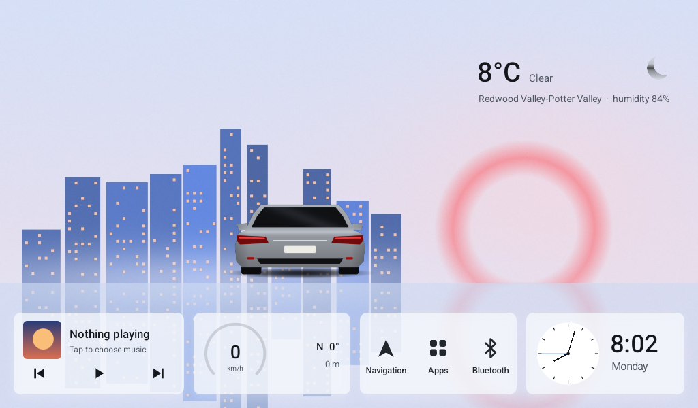 Strip</td>
<td align="center">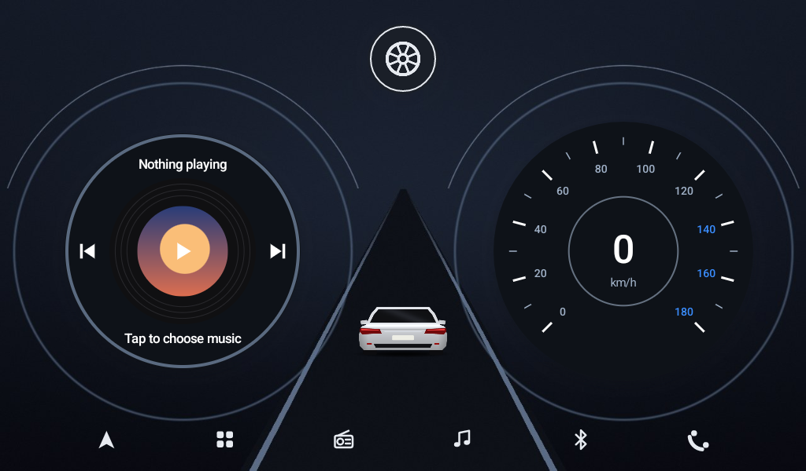 Twin dials</td>
</tr>
</table>

**Setup on first start**

<table>
<tr>
<td align="center">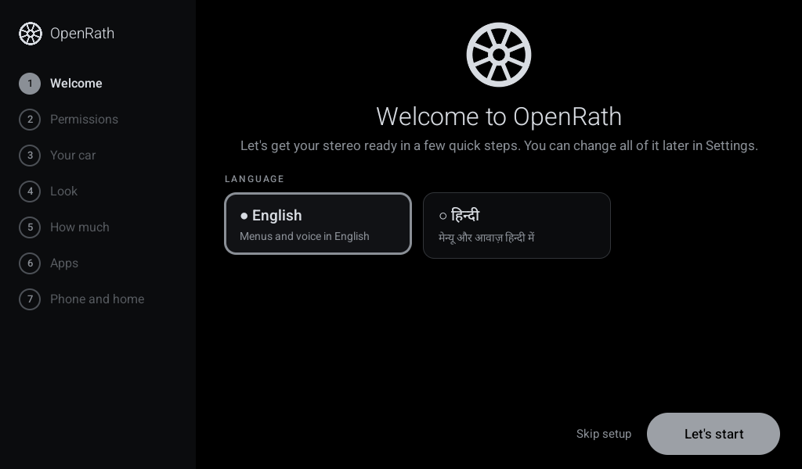 Welcome and language</td>
<td align="center">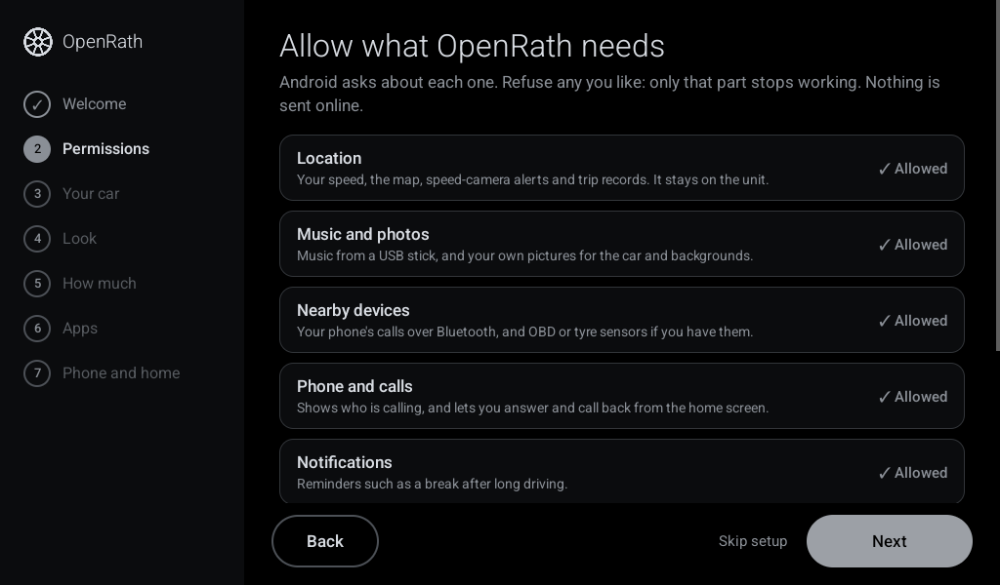 Permissions</td>
</tr>
<tr>
<td align="center">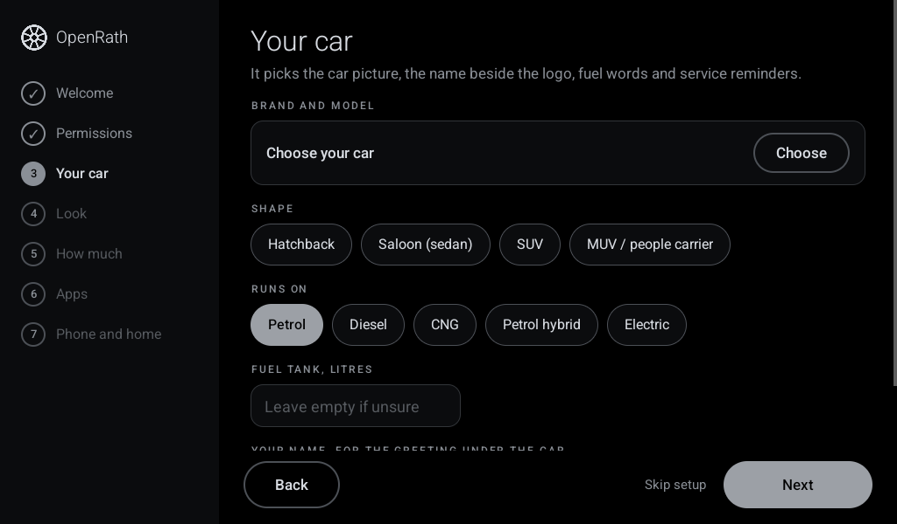 Your car</td>
<td align="center">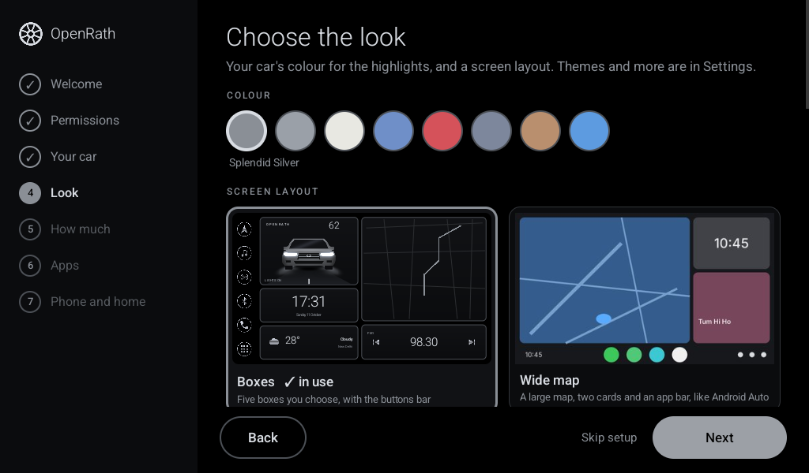 Colour and layout</td>
</tr>
<tr>
<td align="center">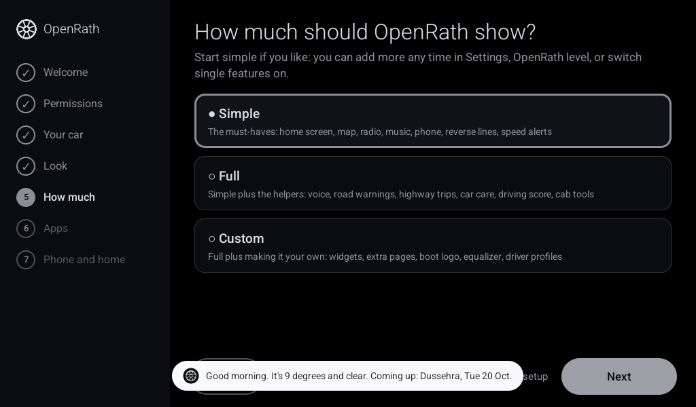 How much to show</td>
<td align="center">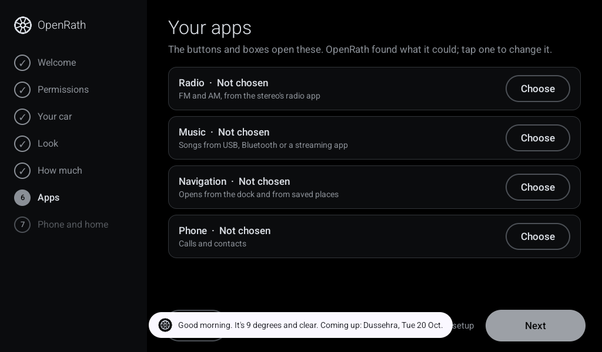 Your apps</td>
</tr>
<tr>
<td align="center">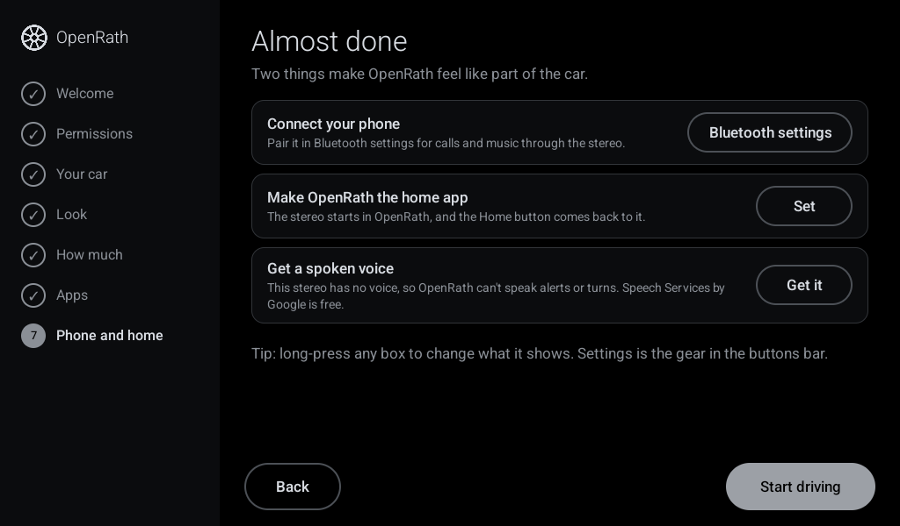 Phone and home app</td>
<td align="center">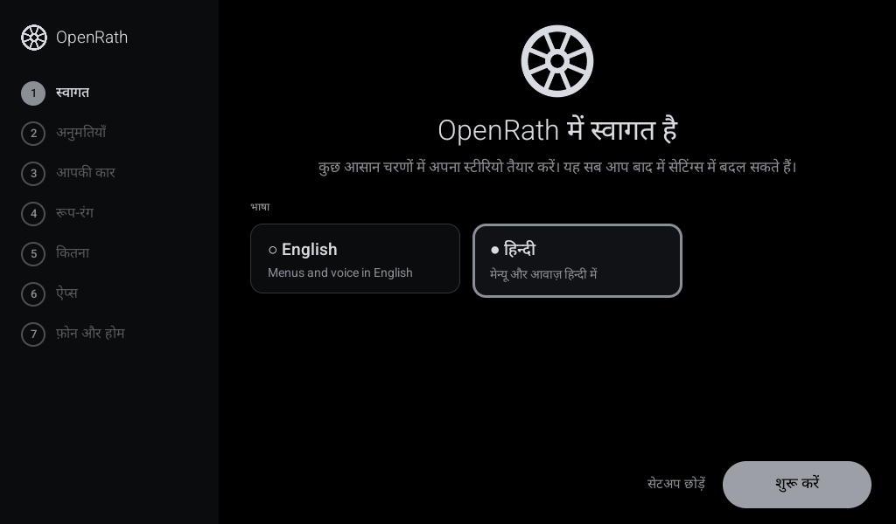 In Hindi</td>
</tr>
</table>

**Settings**

<table>
<tr>
<td align="center">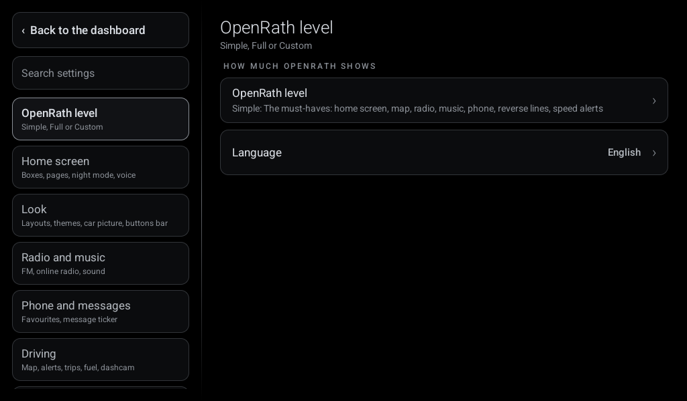 Settings</td>
</tr>
</table>

## Works with

- **Any car.** On the first start, setup screens ask for the brand, model, shape, fuel (petrol, diesel, CNG, hybrid or electric) and tank size. The name beside the logo, the service centre search, fuel words and expected mileage all follow it. Change it any time in Settings > Car.
- **Any screen.** The dashboard is designed at 1024 x 600 and scales to fit any size: 7 to 13 inch, 1280 x 720, 1920 x 720 ultra-wide. Portrait screens stack the boxes with the apps along the bottom. Settings > Dashboard has the size of text and boxes (80 to 130%) and which way up the screen is.
- **Android 8.0 and newer.** It was built on a Topway TS7 (Android 8.1). OpenRath runs on plain Android: the radio box follows any radio app's media controls, and calls go through the system phone (Bluetooth hands-free on most units). Stereo makers' own services are optional add-ons (`Unit.java` is the plain Android version, `TopwayUnit.java` the Topway add-on), loaded only on that make and only while the "Stereo maker's services" switch (developer mode) is on. The Topway add-on (`TopwayUnit.java`) adds FM in the radio box, Bluetooth calls through Topway's phone app and reverse gear. The FYT add-on (`FytUnit.java`) does FM, calls, reverse gear and the headlight wire through the com.syu.ms toolkit service. The MTCD/Joying add-on (`MtcUnit.java`) does FM through CarManager and calls through the android.microntek.mtcser Bluetooth service. The FYT and MTCD add-ons follow the makers' own apps and open-source projects (fyt-dialer, honda-customizer, MTCD-E_Radio-app, MtcDialer) and still need trying on real units. See [docs/STEREOS.md](docs/STEREOS.md) for the common stereo families, their screen sizes and what works on each.

## Install

1. Copy `package/openrath.apk` to the stereo (USB stick or download) and install it with the file manager. Allow installs from unknown sources if asked.
2. Press Home. Android asks which home app to use: pick **OpenRath**, then **Always**. If it doesn't ask, go to Settings > Apps > Default apps > Home app.
3. Open OpenRath. After the logo, the setup screens take you through the language, permissions (or bringing back a backup), your car, the look, how much to show, your apps, and pairing your phone and making OpenRath the home app. Each step can be skipped, and Settings > Help > Run setup again goes through it later.

## Go back to the stock launcher

Settings > Apps > Default apps > Home app, and pick the original launcher. It is never changed or removed.

## Rebuilding

`python3 build.py package` (tools and signing as described at the top of `build.py`; `sh tools/fetch_tools.sh` fetches apktool and the signer). The map uses Leaflet 1.9.4 (BSD-2-Clause, licence in `assets/map`). QR codes on the unit use Project Nayuki's QR Code generator library (MIT, licence at the top of each file in `java/org/openrath/qr`; moved to its own package name so a copy built into the unit's firmware can't be used in its place).

## Licence

GPL-3.0-or-later (see LICENSE), with one additional term under GPLv3 section 7(b): copies and modified versions must keep the credit "Based on OpenRath by Manish Shekhawat" with a link to this project, in their About or credits screen (see [NOTICE.md](NOTICE.md)). Not affiliated with or endorsed by any car or stereo maker; brand names belong to their owners.
